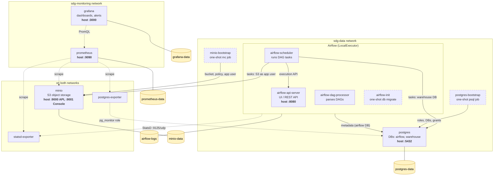

# SDG Tech Challenge — Local Data Platform

Piattaforma dati locale costruita con **Terraform + Docker**: MinIO, database PostgreSQL, orchestratore Apache Airflow e monitoring con Prometheus e Grafana.
L'intero stack si avvia con un solo comando (`make up`).

## Architettura



I container collegati a entrambe le reti sono raggruppati al centro. Le frecce tratteggiate sono
traffico di monitoring e i riquadri tratteggiati sono job one-shot.

Terraform è diviso in due root module con state separati:

- **`terraform/foundation`**: reti, volumi e credenziali (password generate con `random_password`).
- **`terraform/platform`**: immagini, container e job di bootstrap. Legge gli output della
  foundation tramite `terraform_remote_state` e può essere distrutto e ricreato senza perdere dati.

I moduli riutilizzabili sono in `terraform/modules/` (`minio`, `postgres`, `airflow`,
`monitoring`). I DAG di Airflow sono in `terraform/modules/airflow/dags/`, mentre dashboard e
alert di Grafana sono in `terraform/modules/monitoring/grafana/`.

Prometheus e Grafana vivono solo sulla rete `sdg-monitoring` e non raggiungono
PostgreSQL direttamente, ma solo tramite `postgres-exporter` (ruolo `pg_monitor`).

## Prerequisiti

- **Docker** (Docker Desktop, OrbStack o Docker Engine), in esecuzione. Terraform usa il socket
  locale oppure `DOCKER_HOST`.
- **Terraform 1.16.6**, la versione fissata in `.terraform-version`. Con
  [tfenv](https://github.com/tfutils/tfenv): `tfenv install`.
- **make**, **jq** e **curl** (`make credentials` e test).
- Facoltativi, solo per il lint: **tflint**, **shellcheck**, **pre-commit**.

Porte libere sull'host: `9000`, `9001`, `5432`, `8080`, `9090`, `3000`.

## Installazione e avvio

```bash
git clone https://github.com/mellifluus/sdg-tech-challenge sdg-tech-challenge && cd sdg-tech-challenge
tfenv install          # installa la versione di Terraform fissata
make up                # deploy di foundation + platform, senza prompt
make credentials       # stampa endpoint, utenti e password generate
```

Il primo `make up` scarica le immagini e costruisce quella di Airflow, quindi richiede qualche
minuto. Quelli successivi sono idempotenti: senza modifiche, Terraform non cambia nulla.

### Comandi principali

| Comando | Cosa fa |
|---------|---------|
| `make up` | Deploy dell'intero stack senza prompt |
| `make down` | Distrugge solo i container (layer `platform`). Volumi, reti e credenziali restano |
| `make nuke` | Distrugge tutto, **dati compresi** |
| `make plan` / `make apply` | `terraform plan` / `apply` su entrambi i layer, con conferma |
| `make credentials` | Stampa endpoint e credenziali |
| `make output` | Output non sensibili del layer `platform` |
| `make test` | Test di integrazione sullo stack in esecuzione |
| `make test-persistence` | Ricrea i container e verifica che i dati sopravvivano |
| `make lint` | `terraform fmt -check`, `validate` e `tflint` |
| `make help` | Elenco completo dei comandi |

Per cambiare la configurazione si usano le variabili Terraform tramite environment variables, ad
esempio `TF_VAR_minio_buckets='["data-bucket","other"]' make up`. I valori di default sono in
`terraform/*/variables.tf`.

## Test

### Test di integrazione

`make test` (`./tests/run.sh`) esegue i controlli sullo stack già avviato. Legge la
configurazione da `terraform output` ed esegue `mc` e `psql` in container temporanei sulla rete
dello stack, quindi non serve installarli sull'host. Il codice di uscita è il numero di controlli
falliti, così lo script funziona in CI senza modifiche.

Su MinIO lo script verifica che API e Console rispondano, che `data-bucket` esista con il
versioning attivo e che l'utente `app` possa caricare un file ma non creare bucket né
eseguire operazioni di amministrazione. Su PostgreSQL controlla che ogni ruolo possa collegarsi
solo al proprio database. Per il monitoring verifica che tutti i target di Prometheus siano
attivi, che il monitoring network non raggiunga direttamente PostgreSQL e che Grafana abbia
datasource, dashboard e alert provisionati e rifiuti gli accessi anonimi.

Su Airflow controlla lo stato di api-server, scheduler e dag-processor, l'autenticazione delle
API e che ogni DAG in `dags/` sia registrato senza errori di import. Poi carica in
`raw/orders/` un CSV valido e due non validi (header sbagliato e un prezzo con tre decimali dopo
una riga corretta) e avvia `ingest_orders`. Il test attende che il file valido finisca in
`processed/` con le sue righe in `staging.orders`, e che gli altri due finiscano in `rejected/`
senza righe caricate. Verifica anche che la run fallisca, così da far scattare l'alert. Questo
conferma che le connessioni verso MinIO e `warehouse` iniettate da Terraform funzionano. Infine un test end-to-end legge un CSV di
esempio dal bucket, lo carica in una tabella di `warehouse` e confronta il numero di record inseriti con il file originale.

### Test di persistenza

`make test-persistence` (`./tests/persistence.sh`) verifica che i dati sopravvivano ai
container. Scrive un marker in MinIO, PostgreSQL e Grafana e annota
un timestamp che coincide a quando Prometheus ha dati. Poi esegue `make down` e `make up`, controlla che tutti i
container siano stati ricreati, e rilegge ogni
marker. Riavvia lo stack, per questo `make test` non lo include.

### CI

La pipeline GitHub Actions (`.github/workflows/ci.yml`) parte a ogni push su `main` e a ogni pull
request:

1. **Lint & validate**: `make lint` e `shellcheck` sugli script di test.
2. **Deploy, test, destroy**: `make up`, `make test`, `make test-persistence`, poi un
   `terraform plan -detailed-exitcode` su entrambi i layer per verificare che non ci sia drift. In
   caso di errore stampa lo stato e i log dei container, e alla fine esegue sempre `make nuke`.

Gli stessi controlli di lint sono disponibili anche localmente come pre-commit hook oppure con `make pre-commit`.

## Uso dell'AI

Lo sviluppo è stato assistito da Claude Code. Ogni prompt e la relativa risposta sono documentati
in [PROMPTS.md](PROMPTS.md).
