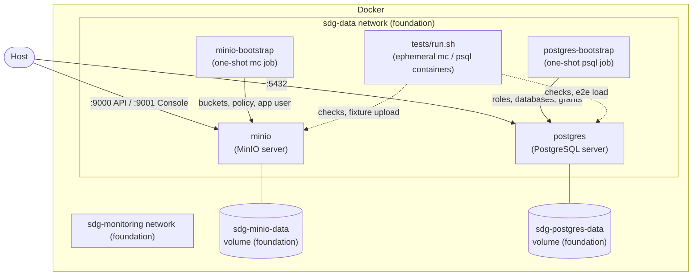

# SDG Tech Challenge — Local Data Platform

Local data platform built with **Terraform + Docker**: MinIO object storage and PostgreSQL.

## Architecture

Two Terraform root modules with separate states: `terraform/foundation` (networks, volumes,
credentials) and `terraform/platform` (images, containers, bootstrap jobs), which reads the
foundation outputs through `terraform_remote_state`. `make up` applies both, `make down` destroys
only the platform so data survives, and `make nuke` destroys both.

## Testing

`make test` (or `./tests/run.sh`) runs integration checks against the deployed stack. It reads
config from `terraform output` and runs `mc` / `psql` in throwaway containers on the stack
network. It needs `docker`, `terraform`, `jq` and `curl`. The exit code is the number of failed
checks, so it can run as-is in CI.

- **MinIO**: API and Console health, `data-bucket` exists with versioning on, the app user
  uploads `tests/fixtures/orders.csv` and the copy in the bucket matches it (sha256), and the
  app user is denied bucket creation and admin operations.
- **PostgreSQL**: the server is ready, and each role can connect to its own database and is
  denied the other one.
- **E2E**: streams the fixture out of the bucket into `warehouse.e2e_orders` (truncate + load
  in one transaction) and checks the row count and total.
